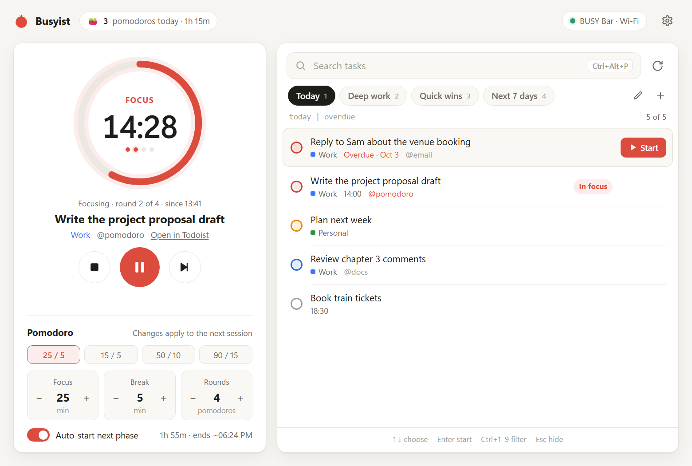

<p align="center"></p>

# buZyist

**Todoist pomodoros on your BUSY Bar.** buZyist is a small Windows tray app: pick a task from
Todoist, and your BUSY Bar runs its focus timer while buZyist keeps track of
what you're working on. No bar? buZyist runs the timer on your PC instead.



> Unofficial. buZyist is a hobby project and is not affiliated with BUSY or Todoist.
>
> buZyist was called Busyist until 1.5.0. Updating keeps your settings and the browser extension
> where they were (`%APPDATA%\Busyist`).

## Download

Get **`Buzyist-Setup-x.y.z.exe`** from the [latest release](https://github.com/josedaidone/buzyist/releases/latest)
and run it. It installs for your user only (no admin rights needed), adds buZyist to the Start
menu, and starts it.

- **"Windows protected your PC"?** buZyist isn't code-signed yet, so SmartScreen warns on first run.
  Click **More info → Run anyway**. You can check the download against `SHA256SUMS.txt` on the
  release page.
- **Updates install themselves.** buZyist checks GitHub for a new release every few hours, verifies
  the download against `SHA256SUMS.txt`, and installs it while no session is running and the
  window is closed. Turn that off in Settings, or use **Settings → About → Check for updates**.
  An install for all users asks for admin rights before updating.
- Prefer no installer? Download the **portable zip**, unzip it anywhere and run `Buzyist.exe`.
  The portable copy tells you when there's a new version but doesn't update itself.
- Needs Windows 10 or 11 (64-bit) and Microsoft's WebView2 Runtime, which Windows 11 already has.
  The installer adds it if it's missing.

## Set up

1. **Todoist** (optional; turn off **Use Todoist** in Settings to run plain focus sessions without a
   task list): in Todoist, open *Settings → Integrations → Developer* and copy your **API token**.
2. **BUSY Bar** (optional; without one, buZyist runs the timer itself, shown by the mini timer and
   the tray icon). In Settings, turn on **Run the timer on a BUSY Bar**, then:
   - **Over Wi-Fi**: the bar's HTTP API is off by default. Plug the bar in over USB, open
     <http://10.0.4.20>, go to *Network → HTTP API*, turn it on and set a PIN. Then find the bar's IP
     under *Settings → Wi-Fi → (your network) → View IP Address*.
   - **Over USB only**: nothing to do, buZyist also tries the bar's USB address.
3. Start buZyist. The first time, it opens on **Settings**: paste the token and, if you have a bar,
   turn it on, enter its IP and PIN and click **Test connection**. Then **Save**.

## Using it

- **Pick a task**: click the tray tomato or press the hotkey (default **Ctrl+Alt+P**), then click a
  task to open its menu (**Start pomodoro** first), or select one with ↑ ↓ and press Enter to start it
  directly. The bar starts its interval timer, the window goes to the tray and the mini timer takes over.
- **No task?** **Start without a task** runs a session with an optional name. It's logged in your
  history, and nothing is sent to Todoist. With **Use Todoist** off, the task list is hidden and the
  window gets narrower.
- **The hotkey cycles**: window → mini timer only → everything in the tray → window again. If the
  window is open but behind other apps, the hotkey brings it to the front first.
- **Saved filters**: the tabs above the list are Todoist filter queries you name yourself
  ("Today", "Deep work", "Quick wins"...). **+** adds one; the pencil, or a double-click on a tab,
  edits, reorders or deletes it. **Ctrl+1–9** switches between them.
- **Pomodoro**: presets (25/5, 15/5, 50/10, 90/15) or your own focus, break and round counts.
- **While it runs**:
  - the window and a small always-on-top **mini timer** show the task, phase and countdown;
  - the tray icon shows the minutes left (red is focus, green is break, amber is paused);
  - pause, skip and stop work from the window, the mini timer or the tray menu.
- **In Todoist**:
  - starting a task adds a label (default `@pomodoro`, which can be removed again when the
    session ends);
  - finished pomodoros are logged as a comment on the task;
  - when the session ends you can complete the task in one click; it drops off the list, the
    filter reloads, and the ✓ counter in the header shows how many tasks you completed today.
- **Keep distractions away during focus** (Settings → Apps and Websites tabs):
  - **Apps**: pick which programs (WhatsApp, Slack, etc.) are closed or hidden to the tray
    while a work phase runs; they come back when you pause, take a break or stop.
  - **Websites**: block instagram, youtube, x, etc. during focus with the bundled **Chrome
    extension** (also works in Edge). Choose **Block these sites**, or **Allow only these sites**
    to block everything else. A plain domain also covers its subdomains, and `*` is a wildcard
    (`*.google.com`, `google.*`, `youtube.com/shorts/*`). A blocked site shows a "back to work"
    page during work phases and returns to itself when focus ends.
- **Website limits** (Settings → Limits): time budgets for websites, enforced all day,
  with or without a pomodoro running.
  - Give a site (or a group of sites that share the time) one or more limits, such as *30 min
    every day* or *5 min every hour*. Each limit can apply to selected days of the week.
  - Add **blocked hours** (e.g. 09:00–17:00 on weekdays; 22:00 to 06:00 runs past midnight).
  - Time counts only while the site is the active tab in the browser window you're using. Once a
    limit is used up, the site shows a page saying when it opens again, with a button to allow a
    couple more minutes.
  - The extension keeps enforcing limits while buZyist is closed and reports the time it measured
    the next time buZyist runs.
  - **Share limits and time with my other PCs** (off by default): the limits, and the time spent on
    them, follow you between PCs through Chrome sync, so 20 minutes of Instagram at work count at
    home too. On each PC, load the extension in a Chrome profile signed in to the same Google
    account, with sync on, and turn the switch on. If a PC has several Chrome profiles with the
    extension, pick the one that shares (the first to connect does, until you pick); the others
    still enforce the limits. Edits made on different PCs are merged rule by rule. Changes reach
    the other PCs within a minute or so of the extension seeing them.
- **App limits** (Settings → Limits): the same time limits and blocked hours for Windows apps
  (`WhatsApp.exe`, `Slack.exe`, ...), measured by buZyist itself: time counts while the app's
  window is in front and you're not idle. Once a limit is reached, buZyist closes the app (asking
  it first, like its X button) until the limit frees up. Or pick **Beep** for a limit: the app
  stays open and buZyist beeps, with a notification saying how long it has been in front, again
  every few minutes it stays there (5 by default; set it per limit). New installs start with
  limits for WhatsApp (30 min a day) and Slack (1 hour a day), set to beep; switch app limits on
  to use them. App limits stay on this PC; they aren't shared through Chrome.
- **The extension's toolbar button**: its badge shows the time left on the current site's limit
  (otherwise the pomodoro minutes left). Click it to see the current pomodoro and your limits.
- **Installing the extension**: in **Settings → Websites**, click **Open Chrome's extensions
  page**. It opens `chrome://extensions`, copies the extension's folder path and shows the folder
  in Explorer. Turn on **Developer mode**, then drag the folder onto the page (or click **Load
  unpacked** and paste the path). The folder is `%APPDATA%\Busyist\chrome-extension`, and buZyist
  keeps it up to date, so it survives updates. When an update changes the extension, buZyist
  shows a **Reload extension** button: click the extension's reload arrow in `chrome://extensions`
  (you don't need to load the folder again).
- Closing or minimizing the window sends it to the tray. buZyist starts with Windows; turn that
  off in Settings.

## Privacy

- buZyist talks to three places only: `api.todoist.com` (only when Todoist is on), your BUSY Bar on
  your own network, and GitHub, to check for and download new releases. There is no telemetry and
  no account.
- For website blocking and limits, buZyist answers the browser extension on `127.0.0.1:47616` (your
  PC only). It only replies to the buZyist extension itself, so web pages can't read what you're
  working on. The extension reports only the time spent on the sites you set limits for, and only
  to buZyist on your PC. It doesn't send your browsing anywhere else.
- Only if you turn on **Share limits and time with my other PCs**: your website limits and the
  time spent on each (per minute today, per day before that), plus your PC's name, are stored in
  Chrome sync, that is with your Google account. Nothing else goes there: not the Todoist token,
  the bar PIN or your other settings.
- Your settings live in `%APPDATA%\Busyist`: `config.json` (including your Todoist token and bar
  PIN, unencrypted), the session, your history, the time spent on limited sites and apps (`usage.json`, `app_usage.json`)
  and a log. **Settings → About → Open data folder**
  takes you there.
- Uninstalling asks whether to delete that folder too.

## Troubleshooting

- **"Bar offline"**: check the IP and PIN in Settings, and that your PC and the bar are on the same
  network. Some office and guest networks block devices from talking to each other.
- **Websites aren't blocked**: **Settings → Websites** should say *Browser extension: connected*.
  If not, check that the extension is turned on in `chrome://extensions`, and that buZyist is
  running. If buZyist shows **Reload extension**, click the extension's reload arrow in
  `chrome://extensions` (or restart Chrome) to load the new version.
- **A website limit doesn't count down**: time only counts while the site is the active tab in
  the focused browser window and you're not idle. Check that **Enforce website limits** is on in
  Settings → Limits.
- **The hotkey does nothing**: another app may own that combination. buZyist warns about this; pick
  another one in Settings.
- **Something else**: the log at `%APPDATA%\Busyist\busyist.log` usually says why. Please attach it
  to an [issue](https://github.com/josedaidone/buzyist/issues). Check it first, since it can contain
  task names.

## Run from source or build it yourself

You need Python 3.11+ on Windows.

```powershell
py -3.11 -m venv .venv
.\.venv\Scripts\python.exe -m pip install -r requirements.txt
.\.venv\Scripts\python.exe busyist.py --show
```

To build the installer and the portable zip into `dist\` (needs [Inno Setup 6](https://jrsoftware.org/isdl.php)):

```powershell
powershell -ExecutionPolicy Bypass -File build.ps1
```

**Releases** are built by GitHub Actions. Bump `__version__` in `busyist.py`, commit, then
push a matching tag:

```powershell
git tag v1.4.0
git push origin v1.4.0
```

Installed copies update themselves from the latest release, so keep the asset names
(`Buzyist-Setup-x.y.z.exe`, `SHA256SUMS.txt`) as `build.ps1` makes them.

The full steps, including test builds and what to do when one fails, are in
[docs/RELEASING.md](docs/RELEASING.md).

Project layout:
- `busyist.py`: the entry point (and `__version__`); `buzyist/`: the app, one module per part (see CLAUDE.md);
- `ui/`: the window and mini timer (HTML/CSS/JS, shown with pywebview);
- `extension/`: the Chrome extension that blocks websites during focus and enforces website limits;
- `packaging/`: the PyInstaller spec and the Inno Setup script;
- `tools/`: the icon and license helpers.

## License

[MIT](LICENSE). buZyist bundles third-party components under their own licenses; see
`THIRD_PARTY_LICENSES.txt` in the app folder.
